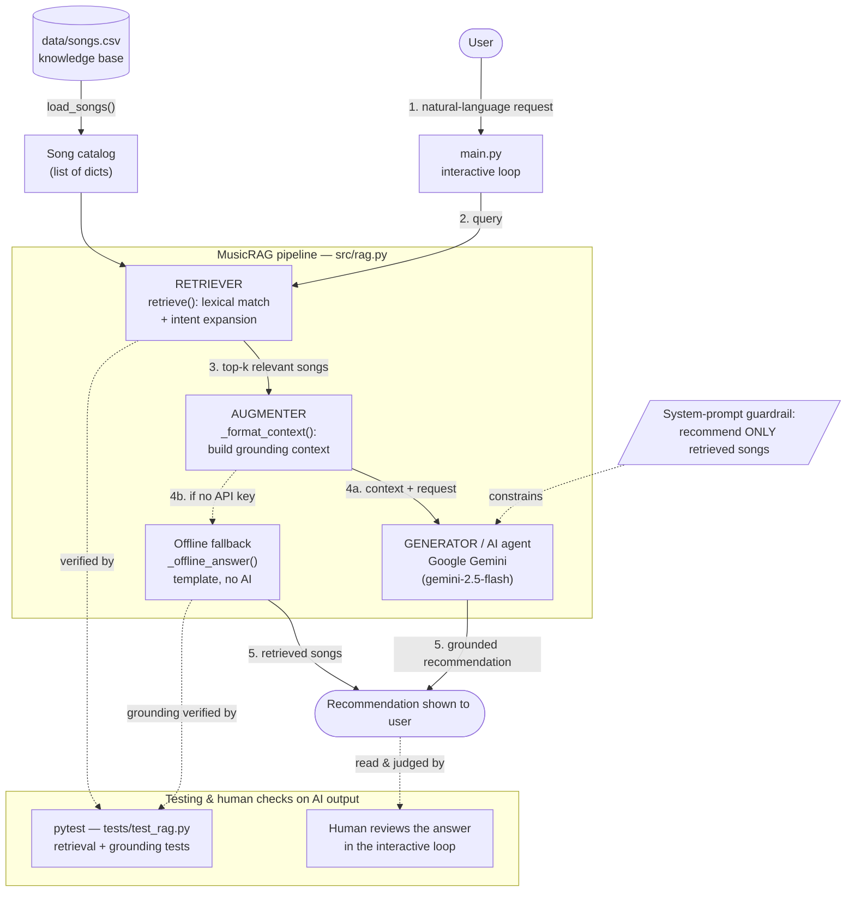

# 🎵 Music Recommender Simulation

## Project Summary

- Represent songs and a user "taste profile" as data
- Design a scoring rule that turns that data into recommendations
- Evaluate what your system gets right and wrong
- Reflect on how this mirrors real world AI recommenders

---

## How The System Works

These features define each 'Song' in the system:
  - genre
  - mood
  - energy
  - tempo
  - danceability
  - valence

'Userprofile' stores:
  - 'favorite_genre'
  - 'favorite_mood'
  - 'target_energy'
  - 'likes_acoustic'

Recommender computes a score for each song by using a ranking rule -> "given all candidates, which ones do I return, and in what order?"
The system chooses which songs to recommend by scoring every candidate, sort by score in a descending order and take the top score.

---

## RAG Feature (Retrieval-Augmented Generation)

The app (`python -m src.main`) now runs as a natural-language assistant powered by RAG,
implemented in `src/rag.py`. Instead of hard-coding a preferences dict, you type a
request in plain English and the system:

1. **Retrieves** — treats `data/songs.csv` as a knowledge base and pulls the songs most
   relevant to your request (lexical matching on genre/mood/title/artist, with intent
   words like "workout" or "studying" expanded to the catalog's labels).
2. **Augments** — injects *only* those retrieved songs into the prompt as context.
3. **Generates** — Google Gemini (`gemini-2.5-flash`) writes a recommendation that
   actively uses the retrieved song data and is instructed to recommend nothing outside
   the retrieved set, so it can't hallucinate songs that aren't in the catalog.

This meaningfully changes the system's behavior: the AI's answer is *grounded* in
retrieved catalog data rather than printed alongside a canned list.

### Architecture



The standalone diagram source also lives in [`diagrams/architecture.mmd`](diagrams/architecture.mmd).

### Enabling AI generation

```bash
export GEMINI_API_KEY=...   # your Google Gemini API key
python -m src.main
```

Without a key, the app still runs in **retrieval-only mode** (it prints the retrieved
songs and notes that AI generation is off), so the pipeline works offline.

Example session with a key set:

```
You: upbeat pop to get hyped for a workout

1. "Gym Hero" by Max Pulse — pop with an intense mood and very high energy (0.93)
   at 132 bpm; built for pushing through a workout.
2. "Sunrise City" by Neon Echo — upbeat, happy pop (energy 0.82, valence 0.84) to
   keep the momentum going.
```

---

## Getting Started

### Setup

1. Create a virtual environment (optional but recommended):

   ```bash
   python -m venv .venv
   source .venv/bin/activate      # Mac or Linux
   .venv\Scripts\activate         # Windows

2. Install dependencies

```bash
pip install -r requirements.txt
```

3. Run the app:

```bash
python -m src.main
```

### Running Tests

Run the starter tests with:

```bash
pytest
```

You can add more tests in `tests/test_recommender.py`.

---

## Sample Recommendation Output

User profile: `genre=pop, mood=happy, energy=0.80, tempo_bpm=120, valence=0.85, danceability=0.80, acousticness=0.15`

```
Top recommendations:

Sunrise City - Score: 99.08
Because: Genre matches your preferred 'pop'; Mood matches your preferred 'happy';
Energy is close to your target (0.82 vs 0.8); Valence is close to your target (0.84 vs 0.85);
Danceability is close to your target (0.79 vs 0.8); Acousticness is close to your target (0.18 vs 0.15);
Tempo Bpm is close to your target (118.0 vs 120)

Gym Hero - Score: 74.83
Because: Genre matches your preferred 'pop'; Energy is close to your target (0.93 vs 0.8);
Valence is close to your target (0.77 vs 0.85); Danceability is close to your target (0.88 vs 0.8);
Acousticness is close to your target (0.05 vs 0.15); Tempo Bpm is close to your target (132.0 vs 120)

Rooftop Lights - Score: 71.41
Because: Mood matches your preferred 'happy'; Energy is close to your target (0.76 vs 0.8);
Valence is close to your target (0.81 vs 0.85); Danceability is close to your target (0.82 vs 0.8);
Tempo Bpm is close to your target (124.0 vs 120)
```

With the starter profile (`genre=pop, mood=happy, energy=0.80` only, no other targets set):

```
Top recommendations:

Sunrise City - Score: 55.78
Because: Genre matches your preferred 'pop'; Mood matches your preferred 'happy';
Energy is close to your target (0.82 vs 0.8)

Gym Hero - Score: 34.57
Because: Genre matches your preferred 'pop'; Energy is close to your target (0.93 vs 0.8)
```

**Screenshot or video** *(optional)*: <!-- Insert a screenshot or demo video link here -->

---

## Experiments You Tried

- **Partial vs. full taste profiles**: `score_song` only scores the preference keys that are present in `user_prefs`, so a minimal profile (just `genre`, `mood`, `energy`) and a full profile (adding `tempo_bpm`, `valence`, `danceability`, `acousticness`) both work without errors. The minimal profile produces lower, more tightly clustered scores since fewer points are available to earn; the full profile spreads scores out more and rewards songs that match on every dimension (see the two sample runs above — `Sunrise City` scores 55.78 on the minimal profile vs. 99.08 on the full one).
- **Weighting categorical vs. numeric features**: genre (25 pts) and mood (20 pts) together are worth as much as all five numeric features combined (11 pts each, 55 pts total). This means a song that matches genre and mood but drifts on every numeric target can still outrank a song with perfect numeric alignment but the wrong genre — e.g. `Gym Hero` (pop, but mismatched mood/tempo) outscores `Night Drive Loop` and `Storm Runner` (right energy, wrong genre) in the sample output.
- **Tempo normalization**: `tempo_bpm` isn't on the same 0.0-1.0 scale as the other features, so its distance is normalized against an assumed 150 bpm catalog spread (`TEMPO_RANGE`) before being compared point-for-point with the other features. Without this normalization, tempo differences (which can be 50+ bpm) would swamp every other feature's contribution.

---

## Limitations and Risks

- **Tiny catalog**: the system only has 10 songs to choose from, so it can't demonstrate how it would behave on a realistic library of thousands of tracks or handle sparse/long-tail genres.
- **No understanding of lyrics, language, or audio**: every feature is a pre-labeled number or category in the CSV. The recommender has no way to judge actual musical content — two songs with identical `energy`/`valence`/`danceability` values could sound nothing alike.
- **Genre/mood matching is exact-string only**: `"pop"` won't match `"indie pop"` or a related genre, so the system can under-recommend reasonable neighbors just because of label mismatch, and is sensitive to how consistently the catalog's labels were applied.
- **Fixed, hand-picked weights**: genre (25) and mood (20) are weighted more heavily than any single numeric feature (11 each) by design choice, not by any learned or validated signal — a different weighting could produce noticeably different rankings for the same catalog.
- **Cold-start / no personalization over time**: the system has no memory of past recommendations or feedback; every call scores the full catalog from scratch against whatever `user_prefs` is passed in.

You will go deeper on this in your model card.

---

## Reflection

Read and complete `model_card.md`:

[**Model Card**](model_card.md)

Write 1 to 2 paragraphs here about what you learned:

- about how recommenders turn data into predictions
- about where bias or unfairness could show up in systems like this

<!-- Draft reflection below — personalize this to your own experience before submitting. -->

Building this recommender made it clear that "recommendation" is really just scoring and sorting: every song gets reduced to a handful of numbers and labels, the system measures how close those numbers are to a target, adds up the points, and returns whatever comes out on top. There's no understanding happening — `score_song` doesn't know what "happy" music actually sounds like, it just checks whether a string matches and whether a float falls close to another float. That gap between what the system is doing (arithmetic on labeled data) and what it looks like it's doing (understanding taste) is the core trick behind most real-world recommenders too.

The bias risk became concrete once I had to decide how much to weight genre and mood versus the numeric features — there's no "correct" answer baked into the data, only a design choice I made, and that choice directly determines whose taste the system serves well. A catalog that under-labels certain genres, or a scoring rule that favors categorical matches over numeric closeness, will systematically push some songs (and the artists behind them) to the top and bury others, not because they're worse matches but because of how the system happens to measure similarity. The same pattern shows up in real recommenders: the weights and features chosen by engineers encode value judgments, and those judgments compound at scale in ways that are easy to miss when you're just looking at one user's results at a time.

