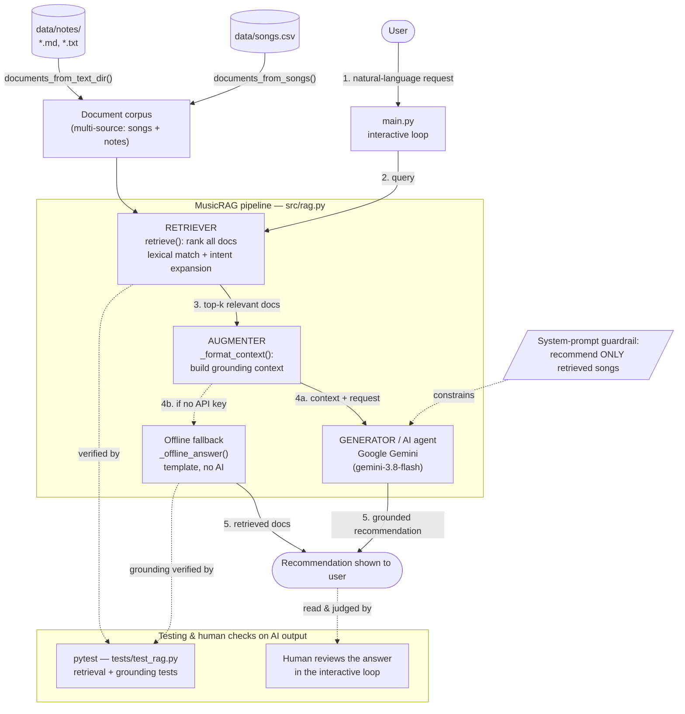

# 🎵 Music Recommender Simulation

## Project Summary

The Music Recommender Simulation represents each song and a user's "taste profile" as structured
data, then applies a hand-designed scoring rule that rewards genre/mood matches and closeness on each
numeric feature to rank every candidate.
The goal was to show how a recommender turns labeled data into predictions through weighting and ranking — and to evaluate where that scoring approach gets things right and where it introduces bias or blind spots.

---

## How The System Works

These features define each 'Song' in the system:
  - genre
  - mood
  - energy
  - tempo
  - danceability
  - valence

'Userprofile' stores:
  - 'favorite_genre'
  - 'favorite_mood'
  - 'target_energy'
  - 'likes_acoustic'

Recommender computes a score for each song by using a ranking rule -> "given all candidates, which ones do I return, and in what order?"
The system chooses which songs to recommend by scoring every candidate, sort by score in a descending order and take the top score.

---

### Architecture

The diagram shows the RAG pipeline that drives the app. A user types a request into the interactive loop, and the retriever searches a **multi-source corpus** — the song catalog (`data/songs.csv`) plus custom reference documents (`data/notes/*.md`) — pulling the top-k most relevant documents using lexical matching plus intent-word expansion. Those documents are passed to the Augmenter, which builds a grounding context block, and then to the Generator, which writes the final recommendation grounded only in the retrieved songs.



The standalone diagram source also lives in [`diagrams/architecture.mmd`](diagrams/architecture.mmd).

### Enabling AI generation

```bash
export GEMINI_API_KEY=...   # your Google Gemini API key
python -m src.main
```

Without a key, the app still runs in **retrieval-only mode** (it prints the retrieved
songs and notes that AI generation is off), so the pipeline works offline.

See the **[Execution Evidence](#execution-evidence)** section below for real captured runs
(end-to-end inputs, AI behavior, guardrail, and test output).

---

## Getting Started

### Setup

1. Create a virtual environment (optional but recommended):

   ```bash
   python -m venv .venv
   source .venv/bin/activate      # Mac or Linux
   .venv\Scripts\activate         # Windows

2. Install dependencies

```bash
pip install -r requirements.txt
```

3. Run the app:

```bash
python -m src.main
```

### Running Tests

Run the starter tests with:

```bash
pytest
```
---

## Execution Evidence

All output below is **captured from real runs** of the RAG system (`python -m src.main`
/ `src/rag.py`), not hand-written. At startup the app reports its multi-source corpus:

```
Sources indexed: songs (10), notes (3)
AI generation: ON (grounded in the song catalog)
```

### 1. End-to-end runs (AI / RAG behavior)

**Input A — `chill lofi for studying`**

Retrieved grounding set (best-first, with relevance scores):

```
[song] Midnight Coding     (relevance 16.5)
[song] Library Rain        (relevance 16.5)
[song] Focus Flow          (relevance 9.0)
[song] Spacewalk Thoughts  (relevance 7.5)
```

AI answer (Gemini, grounded in the retrieved songs):

```
1. "Library Rain" by Paper Lanterns — lofi genre, explicit "chill" mood, gentle
   72 bpm, low energy (0.35), high acousticness (0.86): relaxed and undistracting.
2. "Midnight Coding" by LoRoom — lofi/chill, steady 78 bpm, low-moderate energy
   (0.42), strong acousticness (0.71): a calming backdrop for study sessions.
3. "Focus Flow" by LoRoom — lofi, "focused" mood, smooth 80 bpm, acousticness 0.78.
```

**Input B — `upbeat pop to get hyped for a workout`** (demonstrates multi-source retrieval)

Retrieved grounding set — note the **custom `notes` document** retrieved alongside songs:

```
[song]  Sunrise City          (relevance 11.0)
[song]  Gym Hero              (relevance 11.0)
[notes] Workout Energy Guide  (relevance 8.0)   <-- custom document source
[song]  Rooftop Lights        (relevance 7.0)
```

AI answer (recommends only real catalog songs, informed by the guide note):

```
1. "Gym Hero" by Max Pulse — intense pop, energy 0.93, 132 bpm, danceability 0.88:
   matches the workout guide's criteria for high-energy momentum.
2. "Sunrise City" by Neon Echo — happy pop, energy 0.82, valence 0.84, 118 bpm.
3. "Rooftop Lights" by Indigo Parade — indie pop, 124 bpm, danceability 0.82.
```

### 2. Guardrail behavior (grounding — no hallucination)

**Input C — `classical piano concerto for a formal dinner`** (no match in the catalog)

Every retrieved song scores `0.0` (no lexical match), and the system-prompt guardrail
forbids inventing songs. Instead of hallucinating a classical piece, the AI **honestly
declines** and only offers real catalog tracks, clearly flagged as approximations:

```
None of the songs in the current catalog fit your request for a classical piano
concerto. The available tracks consist of pop, rock, and lofi genres, with no
classical music represented.

If you just need low-energy background music for a dinner setting, the closest
options from the catalog would be:
1. "Library Rain" by Paper Lanterns (lofi, chill, energy 0.35, 72 bpm) — not
   classical, but quiet gentle background sound.
2. "Midnight Coding" by LoRoom (lofi, chill, energy 0.42, 78 bpm) — relaxed and
   downtempo, though distinctly lofi rather than orchestral.
```

### 3. Reliability — graceful offline fallback (no API key)

If no `GEMINI_API_KEY` is set, the app **never crashes** — it degrades to a
retrieval-only response:

```
AI generation available: False
Retrieved from the corpus (AI generation unavailable):
  • [song] Midnight Coding by LoRoom [lofi/chill] (relevance 16.5)
  • [song] Library Rain by Paper Lanterns [lofi/chill] (relevance 16.5)
  • [song] Focus Flow by LoRoom [lofi/focused] (relevance 9.0)
  • [song] Spacewalk Thoughts by Orbit Bloom [ambient/chill] (relevance 7.5)
```

### 4. Automated evaluation (tests)

```
$ pytest
...........                                                              [100%]
11 passed in 0.01s
```

`tests/test_rag.py` checks retrieval ranking, intent-word expansion, multi-source
retrieval (songs + custom documents), and that offline answers stay grounded in real
catalog songs.

---

## Sample Recommendation Output

User profile: `genre=pop, mood=happy, energy=0.80, tempo_bpm=120, valence=0.85, danceability=0.80, acousticness=0.15`

```
Top recommendations:

Sunrise City - Score: 99.08
Because: Genre matches your preferred 'pop'; Mood matches your preferred 'happy';
Energy is close to your target (0.82 vs 0.8); Valence is close to your target (0.84 vs 0.85);
Danceability is close to your target (0.79 vs 0.8); Acousticness is close to your target (0.18 vs 0.15);
Tempo Bpm is close to your target (118.0 vs 120)

Gym Hero - Score: 74.83
Because: Genre matches your preferred 'pop'; Energy is close to your target (0.93 vs 0.8);
Valence is close to your target (0.77 vs 0.85); Danceability is close to your target (0.88 vs 0.8);
Acousticness is close to your target (0.05 vs 0.15); Tempo Bpm is close to your target (132.0 vs 120)

Rooftop Lights - Score: 71.41
Because: Mood matches your preferred 'happy'; Energy is close to your target (0.76 vs 0.8);
Valence is close to your target (0.81 vs 0.85); Danceability is close to your target (0.82 vs 0.8);
Tempo Bpm is close to your target (124.0 vs 120)
```

With the starter profile (`genre=pop, mood=happy, energy=0.80` only, no other targets set):

```
Top recommendations:

Sunrise City - Score: 55.78
Because: Genre matches your preferred 'pop'; Mood matches your preferred 'happy';
Energy is close to your target (0.82 vs 0.8)

Gym Hero - Score: 34.57
Because: Genre matches your preferred 'pop'; Energy is close to your target (0.93 vs 0.8)
```
---

## Experiments

- **Partial vs. full taste profiles**: `score_song` only scores the preference keys that are present in `user_prefs`, so a minimal profile (just `genre`, `mood`, `energy`) and a full profile (adding `tempo_bpm`, `valence`, `danceability`, `acousticness`) both work without errors. The minimal profile produces lower, more tightly clustered scores since fewer points are available to earn; the full profile spreads scores out more and rewards songs that match on every dimension (see the two sample runs above — `Sunrise City` scores 55.78 on the minimal profile vs. 99.08 on the full one).
- **Weighting categorical vs. numeric features**: genre (25 pts) and mood (20 pts) together are worth as much as all five numeric features combined (11 pts each, 55 pts total). This means a song that matches genre and mood but drifts on every numeric target can still outrank a song with perfect numeric alignment but the wrong genre — e.g. `Gym Hero` (pop, but mismatched mood/tempo) outscores `Night Drive Loop` and `Storm Runner` (right energy, wrong genre) in the sample output.
- **Tempo normalization**: `tempo_bpm` isn't on the same 0.0-1.0 scale as the other features, so its distance is normalized against an assumed 150 bpm catalog spread (`TEMPO_RANGE`) before being compared point-for-point with the other features. Without this normalization, tempo differences (which can be 50+ bpm) would swamp every other feature's contribution.

---

## Limitations and Risks

- **Tiny catalog**: the system only has 10 songs to choose from, so it can't demonstrate how it would behave on a realistic library of thousands of tracks or handle sparse/long-tail genres.
- **No understanding of lyrics, language, or audio**: every feature is a pre-labeled number or category in the CSV. The recommender has no way to judge actual musical content — two songs with identical `energy`/`valence`/`danceability` values could sound nothing alike.
- **Genre/mood matching is exact-string only**: `"pop"` won't match `"indie pop"` or a related genre, so the system can under-recommend reasonable neighbors just because of label mismatch, and is sensitive to how consistently the catalog's labels were applied.
- **Fixed, hand-picked weights**: genre (25) and mood (20) are weighted more heavily than any single numeric feature (11 each) by design choice, not by any learned or validated signal — a different weighting could produce noticeably different rankings for the same catalog.
- **Cold-start / no personalization over time**: the system has no memory of past recommendations or feedback; every call scores the full catalog from scratch against whatever `user_prefs` is passed in.

---

## Reflection

[**Model Card**](model_card.md)

Building this recommender made it clear that "recommendation" is really just scoring and sorting: every song gets reduced to a handful of numbers and labels, the system measures how close those numbers are to a target, adds up the points, and returns whatever comes out on top. There's no understanding happening — `score_song` doesn't know what "happy" music actually sounds like, it just checks whether a string matches and whether a float falls close to another float. That gap between what the system is doing (arithmetic on labeled data) and what it looks like it's doing (understanding taste) is the core trick behind most real-world recommenders too.

The bias risk became concrete once I had to decide how much to weight genre and mood versus the numeric features — there's no "correct" answer baked into the data, only a design choice I made, and that choice directly determines whose taste the system serves well. A catalog that under-labels certain genres, or a scoring rule that favors categorical matches over numeric closeness, will systematically push some songs (and the artists behind them) to the top and bury others, not because they're worse matches but because of how the system happens to measure similarity. The same pattern shows up in real recommenders: the weights and features chosen by engineers encode value judgments, and those judgments compound at scale in ways that are easy to miss when you're just looking at one user's results at a time.

